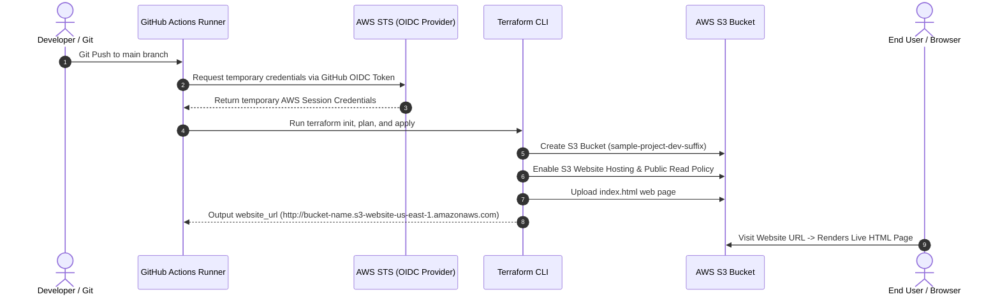

# Sample Project - Automated S3 Static Website Deployment

This project contains a web application (`index.html`) deployed to **AWS S3 Static Website Hosting** using **Terraform** and **GitHub Actions** with **OIDC Authentication** (passwordless, secure authentication).

* **GitHub User**: `krishnaTvc`
* **Repository**: `krishnaTvc/sample-project`
* **Numeric Repository ID**: `1413056262`
* **Numeric Owner ID**: `99535254`

---

## 🏗️ Architecture Overview



---

## 📋 Exact AWS IAM Trust Policy for `krishnaTvc/sample-project`

Copy and paste this exact policy into your AWS IAM Role's **Trust relationships** tab *(just replace `<YOUR_AWS_ACCOUNT_ID>` with your 12-digit AWS Account ID)*:

```json
{
  "Version": "2012-10-17",
  "Statement": [
    {
      "Effect": "Allow",
      "Principal": {
        "Federated": "arn:aws:iam::<YOUR_AWS_ACCOUNT_ID>:oidc-provider/token.actions.githubusercontent.com"
      },
      "Action": "sts:AssumeRoleWithWebIdentity",
      "Condition": {
        "StringEquals": {
          "token.actions.githubusercontent.com:aud": "sts.amazonaws.com",
          "token.actions.githubusercontent.com:repository_id": "1413056262",
          "token.actions.githubusercontent.com:sub": "repo:krishnaTvc/sample-project:ref:refs/heads/main"
        }
      }
    }
  ]
}
```

---

## 📋 Step-by-Step Setup Instructions

### Phase 1: AWS Console Configuration (IAM OIDC & Role)

1. Go to **AWS IAM Console** -> **Identity providers** -> **Add provider**.
   - **Provider URL**: `https://token.actions.githubusercontent.com`
   - **Audience**: `sts.amazonaws.com`
2. Create an IAM Role named `GitHubActions-S3-Deployer-Role`.
3. Attach policy: `AmazonS3FullAccess`.
4. Update **Trust relationships** tab with the exact JSON policy above.

---

### Phase 2: Add GitHub Repository Variables / Secrets

Go to `krishnaTvc/sample-project` on GitHub -> **Settings** -> **Secrets and variables** -> **Actions**:

| Variable / Secret Name | Value | Description |
| :--- | :--- | :--- |
| `AWS_ROLE_ARN` | `arn:aws:iam::<YOUR_AWS_ACCOUNT_ID>:role/GitHubActions-S3-Deployer-Role` | Role ARN |
| `AWS_REGION` | `us-east-1` | Target AWS Region |

---

### Phase 3: Trigger Pipeline & Verify Deployment

1. Go to **Actions** tab in GitHub (`krishnaTvc/sample-project`).
2. Run the **Deploy Sample Project via Terraform** workflow.
3. Once completed, copy the S3 website URL outputted at the end of the run and open it in your browser!
