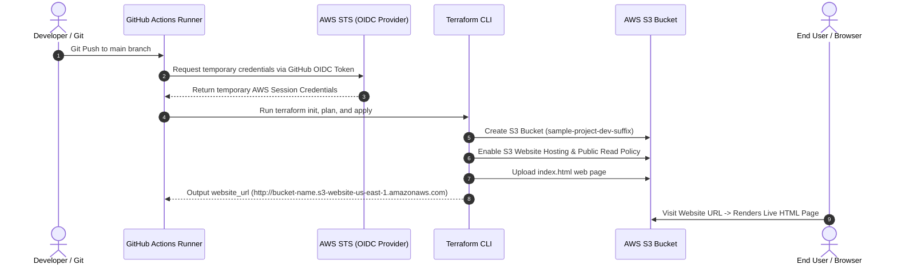

# Architecture & Pipeline Summary

Your repository is fully configured with an automated **GitOps CI/CD deployment pipeline** using **GitHub Actions**, **AWS OIDC Authentication** (keyless security), and **Terraform**.

## Summary of How It Works

1. **Trigger**: Pushing code to `main` (or manually running `workflow_dispatch`) triggers GitHub Actions.
2. **Keyless AWS Auth**: GitHub Actions uses OIDC (`sts:AssumeRoleWithWebIdentity`) to assume your IAM Role without long-lived access keys.
3. **Terraform Execution**:
   - `terraform init`: Initializes providers (`aws`, `random`) with multi-platform lock file verification.
   - `terraform plan` & `apply`: Dynamically provisions an S3 Bucket, configures static website hosting, sets public access permissions, and uploads [`index.html`](file:///d:/Practice-workflow/sample-project/index.html).
4. **Outcome**: Terraform exports the live AWS S3 Website URL (`http://sample-project-dev-<suffix>.s3-website-us-east-1.amazonaws.com`).

---

## Deployment Architecture Diagram

---

## Key Resources Provisioned on AWS

| Resource Name | Terraform Resource | Purpose |
| :--- | :--- | :--- |
| **Unique S3 Bucket** | `aws_s3_bucket.website_bucket` | Hosts static site files securely |
| **Website Config** | `aws_s3_bucket_website_configuration` | Configures `index.html` as entry point |
| **Public Policy** | `aws_s3_bucket_policy` & `ownership` | Allows public web browsers `s3:GetObject` access |
| **Website Content** | `aws_s3_object.index_html` | Deploys your frontend content automatically |

🎉 **Your pipeline is live and ready for deployment!**
